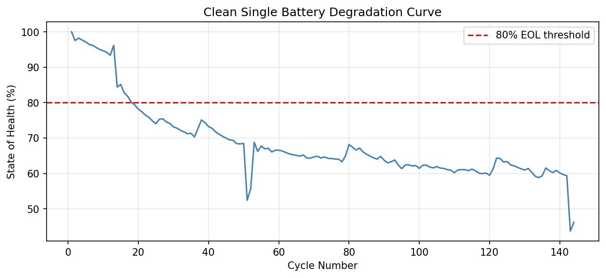
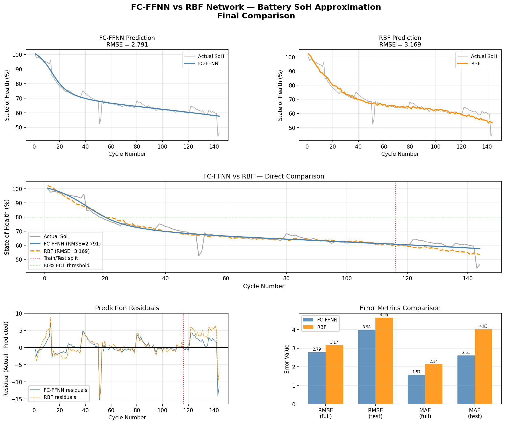
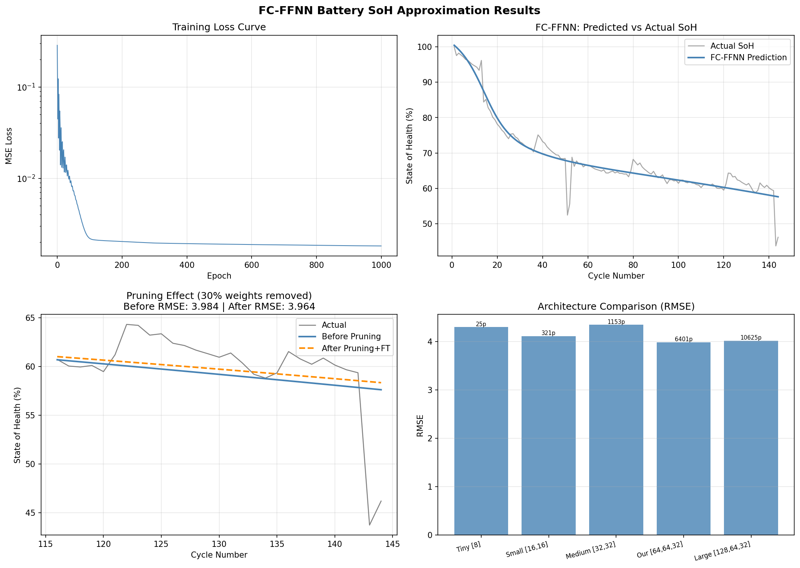
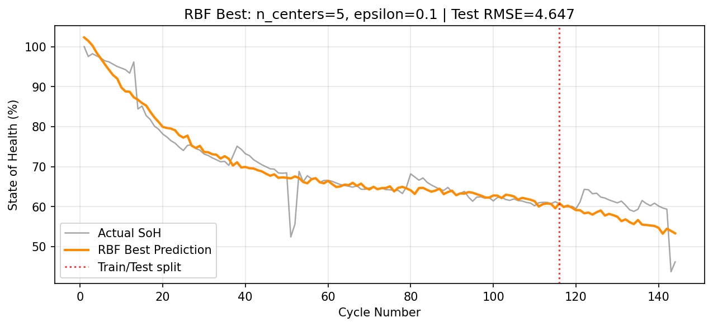
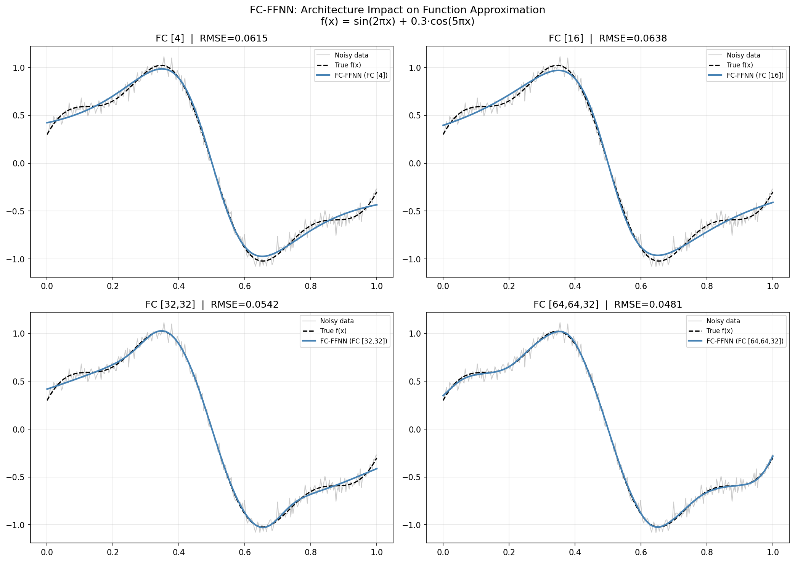
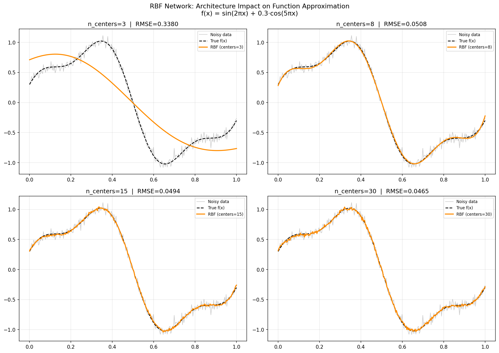

# Battery State of Health Approximation: FC-FFNN vs RBF Network

Predicting the **State of Health (SoH)** of a Li-ion battery from its cycle number using real NASA
discharge data. The project compares two classic function approximators, a fully connected
feedforward neural network (FC-FFNN) and a radial basis function (RBF) network, and studies magnitude
pruning, architecture size and RBF hyperparameter sensitivity.

$$\text{SoH}(n) = \frac{C_n}{C_0} \times 100\\%, \qquad f: \text{cycle} \rightarrow \text{SoH}$$

## Highlights

- **Data pipeline from raw sensor logs.** Capacity is computed per discharge cycle by integrating
  measured current over time (trapezoidal rule), then normalized to SoH.
- **FC-FFNN in PyTorch.** Architecture study plus 30% global magnitude pruning with fine-tuning.
- **RBF network from scratch in NumPy.** K-means centers, Gaussian kernels and closed-form
  least-squares output weights.
- **Honest evaluation.** A chronological 80/20 split with no shuffling. The test set is the *last*
  29 cycles, so it measures extrapolation.

## Data

NASA Ames Prognostics Center of Excellence (PCoE) Li-ion battery aging data. Each CSV in
[`battery_data.zip`](battery_data.zip) is one cycle (voltage, current, temperature, time). Capacity is
extracted from every discharge cycle, and a single battery's 144-cycle segment is used for modelling
([`battery_clean.csv`](battery_clean.csv)).



## Results

Both models are trained on cycles 1–115 and evaluated on cycles 116–144, which they never saw.
Errors are in SoH percentage points.

| | FC-FFNN | RBF |
|---|---|---|
| Architecture | 1 → 64 → 64 → 32 → 1 (Tanh) | 1 → 5 Gaussians → 1 |
| Parameters | 6,401 | **11** |
| Training | Backpropagation (Adam, 1000 epochs) | K-means + least squares (closed form) |
| **Test RMSE** | **3.98** | 4.65 |
| **Test MAE** | **2.61** | 4.03 |
| Test RMSE after 30% pruning + fine-tune | 3.96 | N/A |



### Takeaways

- **The FC-FFNN generalizes better** on the unseen tail of the degradation curve.
- **The RBF network is ~580× smaller** and trains instantly in closed form, but it is fragile. With
  too many centers or too large a shape parameter ε the design matrix becomes ill-conditioned and the
  test RMSE explodes past 200.
- **Pruning 30% of FC-FFNN weights costs nothing** after a short fine-tune (RMSE 3.98 → 3.96), so the
  network is heavily over-parameterized for this 1-D problem. Architectures from 25 to 10,625
  parameters all landed between 3.98 and 4.35 RMSE.

### FC-FFNN: training, fit, pruning and architecture study



### RBF: best configuration (K = 5, ε = 0.1)



### Function approximation warm-up

Before using battery data, both networks fit a noisy synthetic curve
$f(x) = \sin(2\pi x) + 0.3\cos(5\pi x)$ to show how capacity (layers / centers) affects the fit.

| FC-FFNN | RBF |
|---|---|
|  |  |

## Repository structure

```
├── notebook.ipynb        # full analysis: Parts 0–4
├── battery_data.zip      # raw NASA discharge-cycle CSVs
├── battery_clean.csv     # extracted 144-cycle SoH curve used for modelling
├── images/               # figures used in this README (written by the notebook)
└── requirements.txt
```

## How to run

**Google Colab:** upload `notebook.ipynb` and `battery_data.zip`, then *Runtime → Run all*. Figures are
written to `images/`.

**Locally:**

```bash
pip install -r requirements.txt
jupyter notebook notebook.ipynb
```

The notebook extracts `battery_data.zip` itself and uses relative paths, so run it from the repository
root.

## Notebook outline

0. **Function approximation demo**: the Universal Approximation Theorem in practice
1. **Data extraction**: capacity via numerical integration → SoH curve
2. **FC-FFNN**: training, magnitude pruning and an architecture study
3. **RBF network**: K-means centers, least-squares weights, sensitivity to ε and number of centers
4. **Comparison**: metrics, residuals, summary table and conclusion
